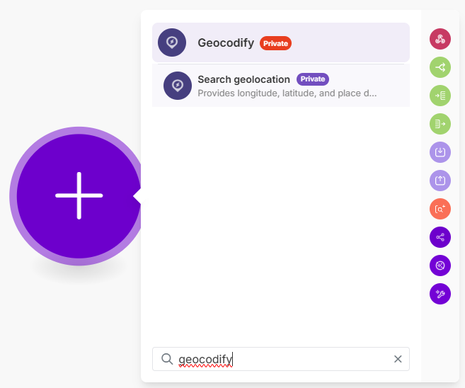

# Make 的 GPT Image 集成，由 Ace Data Cloud 提供

独立服务App源项目：**Generate a GPT Image image**、**Get a GPT Image task**、**Make an API call**。使用自己的Ace应用Token，不冒充第三方官方。[English](README.md)。

**Community目录名称按当前表单填写 `GPT Image`，不把开发者公司名加进App名称；Ace Data Cloud身份放在描述、提供者和landing页。** README标题只是说明集成提供者，不是已批准目录名。[2026-10-19核验的投稿规则](../COMMUNITY_SUBMISSION.md)。

型号和画质选项由 `scripts/sync_from_platformbackend.py --services openai` 从固定的 OpenAI 兼容图片 API 合同刷新，覆盖该 API 合同中的全部型号。请选择对应型号支持的画质（DALL-E 2 使用 `standard`；DALL-E 3 使用 `standard` 或 `hd`）。本原生动作仍只返回一张图片 URL；编辑、base64 或未展示参数请使用 Make an API Call。本仓库提供私有 Make 应用源码，不代表已获官方市场审批。

## 1. 正确安装入口

**官方Make安装链接待发布，尚未部署、审核或上架。** 发布后核对提供者为Ace Data Cloud，再装到目标组织。开发者用本目录manifest配对自己的独立测试App，先查已有应用，不能指向Suno/聊天/其他服务origin。[配对说明](../README.md#set-up-a-private-testing-app)。

原图是Geocodify，2026-10-17下载，原拍摄日期/版本未知；不证明GPT Image已安装。[来源](../suno/ASSET_SOURCES.md)。

## 2. 复制 Ace Data Cloud API Key

登录[应用列表](https://platform.acedata.cloud/console/applications?utm_source=make&utm_medium=integration&utm_campaign=evergreen)，打开**通用应用**。首次使用时先点击**初始化通用应用**，再点击 **API KEY** 旁的复制按钮（图中标注 **1**）。

检查有效期、用量限制、余额与[当前价格](https://platform.acedata.cloud/models?utm_source=make&utm_medium=integration&utm_campaign=evergreen)。允许API需覆盖生成`/openai/images/generations`、查询`/openai/tasks`和连接读取`/v1/models`，不盲目扩权。

1. 在已安装模块点 **Create a connection**，把原始Token填进 **AceDataCloud API token**，不加Bearer，不用platform管理Token或Make开发Key。保存只做免费模型GET；认证不代表生成权限和余额已足够。

## 3. 首版范围与同ID查询

本服务首版范围（精确字段见英文参数表）：

One generated image only: `n=1`, `response_format=url`, GPT Image 2 / 2.5 Flare / 2.5 Sunburst, explicit size and quality. No image editing, base64 output, partial-image preview, unrelated model or fallback. The task returns the image in `response.data[0].url` (Make index 1).

获准预算后只运行一次生成，返回task_id/pending，不代表完成。把Task ID用变量选择器映射到 **Get a GPT Image task**；它只调用`/openai/tasks`的retrieve，不生成。pending时使用仅查询场景读同ID，不重跑生成。只有Status=succeeded、Terminal success=true时使用 **Completed image URL**。模型/尺寸/时长受当前账户与模型约束，不能把其他服务字段照搬。

先免费运行通用模块 **GET /v1/models**，再查询自己已有任务；没有已成功任务就保留待验收，不使用他人ID。检查原任务/trace和唯一生成账单，Make操作额度与Ace Credits分开；[请求记录](https://platform.acedata.cloud/console/usages?utm_source=make&utm_medium=integration&utm_campaign=evergreen)。

## 4. 常见问题与发布

- 401：检查完整原始Token、有效期、允许API、服务权限、余额/限额。
- 400：核对本服务字段、模型和大小写分辨率；不套其他服务参数。
- pending/无链接：继续查同一ID；预览不是终态，不重新生成。
- failed/字符串或未知结构：保留task/trace检查，不猜成功。
- 429/超时/5xx：先看请求记录，场景重放/传输错误仍可能导致重复付费；本源不设自动应用错误重试或fallback。

发布须真实Make场景、日志脱敏、独立安装、资格/名称/商标确认和[发布材料](PUBLICATION.md)。当前只有源码和离线验证，无市场版本/真实宿主/新生成账单证明。
